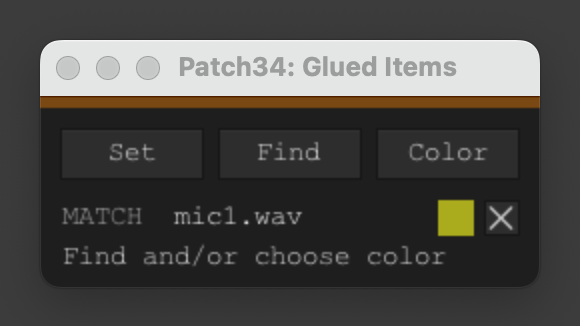

# Find and Recolor Glued Items

[English](README.md) · **Русский**

Находит и окрашивает результаты команды Glue, соответствующие имени выбранного медиаэлемента.

## Работа скрипта

| Действие | Назначение |
| --- | --- |
| **Set** | Запоминает имя выбранного элемента либо активного тейка. |
| **Find** | Выделяет во всём проекте подходящие результаты Glue. |
| **Color** | Выбирает цвет и применяет его к совпадениям, а также к новым результатам Glue, пока скрипт работает. |
| **Reset** | Очищает запомненные имя и цвет, отключает автоматическую окраску. |

Совпадение определяется по имени элемента (или основе имени без расширения) и наличию `glued`. Например: `MIC2.WAV-glued-01` и `MIC2-Glued-001`. Для работы автоматического режима окно скрипта должно оставаться открытым. js_ReaScriptAPI не требуется.

## Установка

### Через ReaPack

Добавьте [каталог Patch34 ReaPack](https://raw.githubusercontent.com/patch-34/patch34-reapack/main/index.xml) через **Extensions → ReaPack → Import repositories…**, затем найдите **Find and Recolor Glued Items** в **Browse packages**, установите и синхронизируйте пакет.

### Вручную

1. Скопируйте `Find_and_Recolor_Glued_Items.lua` в папку `Scripts` ресурсов REAPER.
2. Зарегистрируйте файл через **Actions → Show action list → New action → Load ReaScript**.
3. Запустите действие. Если необходимо, назначьте сочетание клавиш или кнопку панели инструментов.

При ручном обновлении сохраняйте путь и имя файла.

## Лицензия и авторство

Лицензия [MIT](LICENSE).

Автор: [Aleksei Vorobev / Patch34](https://github.com/patch-34).
